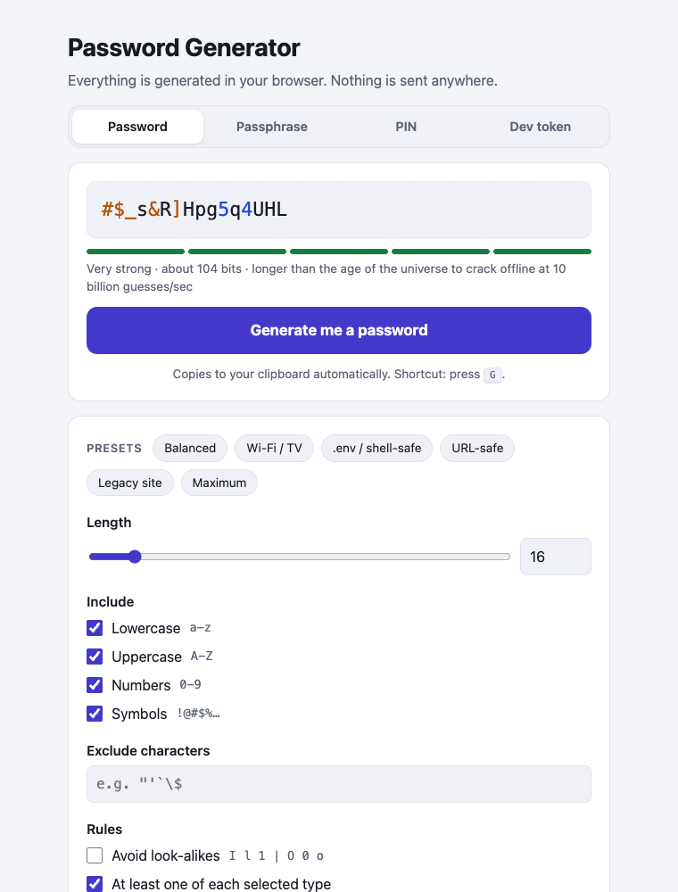

# Random Password Generator

Generate a strong password with one click and have it copied straight to your clipboard.
It also makes passphrases, PINs and developer tokens. Everything runs in your browser,
so nothing you generate is ever sent anywhere.

**[Live demo →](https://badrri-narayanan.github.io/random-password-generator/)**

<p align="center">
  
</p>

## Features

- **One click: generate and copy.** Press **Generate me a password** (or the <kbd>G</kbd> key) and the result is already on your clipboard.
- **Four modes**

  | Mode | Example | Good for |
  | --- | --- | --- |
  | Password | `#$_s&R]Hpg5q4UHL` | Website and app logins |
  | Passphrase | `Yellow-Alley0-Meadow-Reindeer-Bold-Thimble` | Master passwords and computer logins you need to remember |
  | PIN | `700993` | Phones, bank cards, door codes. Never `1234`, `0000` or `9876` |
  | Dev token | `75f2e1bc…c74640`, base64url or UUID v4 | API keys, JWT/session secrets, webhook signing keys |

- **Password options:** length, lowercase, uppercase, numbers, symbols, a box for characters to exclude, an option to avoid look-alike characters (`I l 1 | O 0 o`), and "at least one of each selected type".
- **Presets for common situations**

  | Preset | What it does |
  | --- | --- |
  | Balanced | 16 characters, every type (the default) |
  | Wi-Fi / TV | 20 characters, no symbols, no look-alikes. Easy to type with a TV remote or read aloud |
  | .env / shell-safe | 32 characters without quotes, `$`, `\` and other characters that break config files and scripts |
  | URL-safe | 24 characters; the only symbols are `- _ . ~` |
  | Legacy site | 12 characters; the only symbols are `! @ # $ % ^ & *`, for fussy older sites |
  | Maximum | 64 characters, every type, for a password manager |

- **Strength meter:** entropy in bits, plus an estimated time to crack offline at 10 billion guesses per second. For PINs it gives the odds per guess instead, because a PIN's protection comes from the device locking after a few wrong attempts.
- **Easy to read:** digits and symbols are coloured so similar-looking characters are easier to tell apart.
- **Bulk generation:** up to 50 at a time, all copied together, one per line.
- **Clipboard auto-clear** after 15, 30 or 60 seconds (optional).
- **Recent history:** hidden until you click Show, and gone when you close the tab.
- Remembers your settings between visits (never your passwords). Supports light and dark mode, phones, and keyboard-only use.

## Defaults

| Setting | Default |
| --- | --- |
| Password length | 16 (slider 4–128; up to 256 by typing a number) |
| Lowercase, uppercase, numbers, symbols | All on |
| At least one of each selected type | On |
| Avoid look-alikes | Off |
| Exclude characters | Empty |
| Passphrase | 6 words, `-` separator, capitalized, one number added (about 61 bits) |
| PIN | 6 digits, obvious patterns avoided |
| Dev token | Hex, 32 bytes (256-bit) |

## How it works

- **Randomness:** everything comes from the browser's `crypto.getRandomValues` (Web Crypto API), never `Math.random`.
- **No bias:** random indexes are drawn with rejection sampling, so every character is equally likely. A plain `random % n` would make some characters slightly more likely than others.
- **"At least one of each type"** puts one character from each selected type in the password, fills the rest from all of them, then shuffles the whole thing with a Fisher–Yates shuffle, so the guaranteed characters don't land in predictable places.
- **Passphrases** use a built-in list of 605 short, common words, about 9.2 bits of entropy per word.
- **Strength** is calculated as `length × log2(number of possible characters)`. Crack time assumes an attacker making 10¹⁰ guesses per second against a fast hash and finding the password after trying half of all possibilities on average.
- **Privacy:** there's no server, no analytics and no network requests. Only your settings are saved in `localStorage`; passwords and history live in memory and disappear when you close the tab.

## Run locally

There's no build step and nothing to install. Either open `index.html` in a browser, or serve the folder:

```sh
python3 -m http.server 8000
# open http://localhost:8000
```

Browsers only allow automatic clipboard copying on `https://` pages or `localhost`. If you open the file directly (`file://`), the app falls back to an older copy method, and if that fails too it asks you to copy by hand.

## Tests

The generation logic is covered by unit tests that use Node's built-in test runner (Node 20 or later):

```sh
node --test tests/
```

They check that lengths and allowed characters are respected, that the one-of-each rule and the exclusions hold, that random numbers are evenly distributed, that passphrases and tokens have the right format, that weak PINs are rejected, and that impossible settings give a clear error.

## Project structure

```
├── index.html              # page markup
├── styles.css              # styles, light and dark themes
├── app.js                  # UI: settings, clipboard, history, keyboard shortcut
├── generator.js            # pure generation and strength logic (browser + Node)
├── wordlist.js             # passphrase word list
├── tests/generator.test.js # unit tests
└── docs/screenshot.png
```

`generator.js` has no DOM code, so the same file runs in the browser (as `window.PwGen`) and in Node (via `require`) for the tests.

## Deployment

The site is hosted on GitHub Pages from the root of the `main` branch. Every push to `main` updates the live site within a minute or two.

## License

[MIT](LICENSE) © 2026 Badrri Narayanan S
